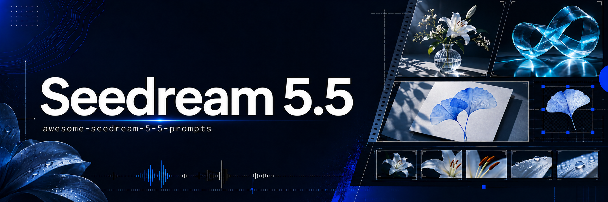

<p align="center"><a href="https://beatapi.io"></a></p>

# Awesome Seedream 5.5 Prompts

Seedream 5.5 images and prompts, curated by [BeatAPI](https://beatapi.io).

**[BeatAPI home](https://beatapi.io)** · **[Browse the prompt gallery](https://beatapi.io/seedream-5-5-prompts)** · **[Seedream 5.5 API](https://beatapi.io/seedream-5-5-api)** · **[中文说明](README.zh-CN.md)** · **[Contribute a prompt](CONTRIBUTING.md)**

**92 examples · 29 complete prompts**

**Browse by use case:** [Typography](#typography) · [Portraits](#portraits) · [Transparent assets](#transparent-assets) · [Photography](#photography) · [Product](#product) · [Landscape](#landscape) · [Editing](#editing) · [Illustration](#illustration) · [Creator showcases and model comparisons](#creator-showcases-and-model-comparisons)

## Latest examples

### Tourbillon watch campaign

<a href="https://media.beatapi.io/prompt-gallery/seedream-5-5/6c6879284822dc421c6a8bdcfa5c5c1e8141a8449dbf270f17ea732702e3ff48.webp"></a>

<a href="https://media.beatapi.io/prompt-gallery/seedream-5-5/fa190a9bc951ef7bcce2b1653d125659252831fb08a4943516be81b656ac39e2.webp"></a>

[@marryevan999](https://x.com/marryevan999/status/2120217177890652585)

### Rainbow paper-quilling dancer

<a href="https://media.beatapi.io/prompt-gallery/seedream-5-5/48cdb017f2219058bc661fa03688e63ce6dfff4051d75ef181393d30e820c112.webp"></a>

<details>
<summary>Prompt</summary>

~~~~text
3D paper quilling art of a graceful woman dancing in side-profile. She wears an elegant sleeveless v-neck dress made of intricately coiled paper strips in a vivid rainbow gradient—transitioning seamlessly through yellow, orange, red, magenta, deep purple, royal blue, and emerald green.

Her long brown hair flows in the wind behind her as she gracefully holds an open quilled umbrella featuring matching rainbow paper panels overhead. She wears bright red high heels, standing atop quilled paper water ripples reflecting vibrant hues. Surrounding her in mid-air are multiple detailed quilled paper butterflies in shades of bright orange, yellow, pink, and sky blue.

The background is a solid matte dark charcoal grey cardstock, featuring subtle overhead studio directional lighting that casts soft 3D drop shadows underneath the layered paper elements, emphasizing realistic texture and depth. High detail, paper craft sculpture aesthetic, 4k resolution. --ar 2:3
~~~~

</details>

[@yourPlugAI](https://x.com/yourPlugAI/status/2120176960999403776)


## Typography

### Magazine cover typography


<details>
<summary>Prompt</summary>

```text
Premium magazine cover design titled “THE FUTURE OF CREATIVE TOOLS”, with a realistic portrait of a stylish creative director in the lower third. Dense small cover lines around the edges: “Issue 24”, “AI Workflows”, “Design Systems”, “Cinematic Image Making”, “Inside the Studio”, “November 2026”. Clean modern serif masthead, precise kerning, crisp letterforms, editorial grid, muted cream background, subtle paper texture, high-end print-design layout. All text must be spelled exactly as written, no distorted letters, no duplicated words, no gibberish.
```

</details>

[@Dheepanratnam](https://x.com/Dheepanratnam/status/2119767938173387065) · [Details](cases/dheepan-typography-5.md)

### Rainy storefront at night


<details>
<summary>Prompt</summary>

```text
Photorealistic street scene in a multicultural London neighbourhood at night. A shopfront sign reads exactly “OPEN LATE” in English, with a smaller hanging sign reading exactly “欢迎光临” in simplified Chinese and another small poster reading exactly “Bienvenue” in French. Realistic neon glow, legible typography, correct character shapes, no duplicated letters, no warped glyphs, natural perspective on the signs, cinematic night photography, wet pavement reflections, no extra invented text.
```

</details>

[@Dheepanratnam](https://x.com/Dheepanratnam/status/2119767938173387065) · [Details](cases/dheepan-typography-6.md)

### Minimal skincare label


<details>
<summary>Prompt</summary>

```text
Minimalist skincare packaging mock-up on a pale stone pedestal. A frosted-glass serum bottle has a clean label reading exactly “LUMEN — BARRIER REPAIR SERUM”, with smaller text beneath: “30 ml / 1.0 fl oz”. Elegant sans-serif typography, perfectly straight label alignment, crisp small print, realistic glass refraction, soft studio lighting, subtle shadow, premium cosmetic advertising photography, no misspelled words, no extra branding, no watermark.
```

</details>

[@Dheepanratnam](https://x.com/Dheepanratnam/status/2119767938173387065) · [Details](cases/dheepan-typography-7.md)

### Night Signal event poster


<details>
<summary>Prompt</summary>

```text
Bold gig poster for an underground electronic music night. Large headline reads exactly “NIGHT SIGNAL”, with supporting text: “Friday 27 November”, “Warehouse 9, London”, “Doors 10PM”. Experimental Swiss-style layout, high-contrast black, off-white and electric blue, grainy risograph texture, sharp geometric typography, intentional negative space, screen-print aesthetic. All words spelled exactly as specified, no extra text, no warped letters, no AI artefacts.
```

</details>

[@Dheepanratnam](https://x.com/Dheepanratnam/status/2119767938173387065) · [Details](cases/dheepan-typography-8.md)

### Ramen menu with bilingual text


<details>
<summary>Prompt</summary>

```text
Overhead photo of a printed noodle shop menu on a dark wooden counter. Title 'KAZE RAMEN' in bold brush lettering, small Japanese subtitle '風ラーメン', and a neat list with exact text: 'Shoyu Ramen 980', 'Miso Ramen 1,050', 'Gyoza (6) 420', 'Oolong Tea 280'. Small footnote: 'Open daily 11:00-22:00'. A steaming bowl sits at the edge of the frame, soft window light.
```

</details>

[SpicyAPI Engineering](https://spicyapi.ai/reviews/seedream-5-5) · [Details](cases/spicyapi-seedream55-01.md)

### Lantern Tea House poster


<details>
<summary>Prompt</summary>

```text
A vintage screen-print travel poster for a fictional tea house, portrait format. At the top, a large bold serif headline in English reading exactly "LANTERN TEA HOUSE". Directly beneath it, a Chinese title in brush calligraphy reading exactly "灯笼茶馆".
In the centre, a flat illustration of a glowing red paper lantern with no writing on it, hanging above a steaming clay teapot and two small cups, under a deep indigo night sky with a single crescent moon and a few stars, with saffron and cream accents and a subtle paper grain. At the bottom, two lines of small, clean sans-serif text: the first reading exactly "Open nightly from 8 PM to 2 AM" and the second reading exactly "每晚八点至凌晨两点营业".
These four lines are the only text on the poster, with no signs, labels or characters anywhere else. All lettering crisp, correctly spelled and fully legible, generous margins.
```

</details>

[Seedream Studio](https://seedreamv5.com/seedream-5.5) · [Details](cases/seedream-studio-poster.md)

### From seed to salad infographic


<details>
<summary>Prompt</summary>

```text
Create an illustrated infographic poster titled “FROM SEED TO SALAD” on warm-white paper with a handmade print texture. One continuous path snakes across three tiers, linking six numbered stages in order: SOW, SPROUT, GROW, TEND, HARVEST and SHARE. Five correctly directed arrows connect the sequence. Pair miniature gardening scenes and English descriptions with each stage, keeping the reading order clear, lettering legible and colors soft yet varied.
```

</details>

[ByteDance Seed](https://seed.bytedance.com/en/seedream5_5) · [Details](cases/bytedance-official-infographic.md)

### Shakespeare literary newspaper


<details>
<summary>Prompt</summary>

```text
Design a landscape literary newspaper with the masthead “THE SHAKESPEARE CHRONICLE” and the headline “WILLIAM SHAKESPEARE”. On warm ivory paper, illustrate Shakespeare and the Globe Theatre in black engraving, with muted blue clouds and waves weaving through the page. Arrange seven short articles in English around the illustrations, using bold serif headings and legible small type.
```

</details>

[ByteDance Seed](https://seed.bytedance.com/en/seedream5_5) · [Details](cases/bytedance-official-newspaper.md)


## Portraits

### Noir fashion magazine cover


<details>
<summary>Prompt</summary>

```text
Fashion magazine cover photograph. A woman in her early thirties with auburn hair in a low-cut emerald silk dress with thin straps, looking at the camera in soft window light. The only text on the cover: the large serif masthead 'NOIR', one small Japanese line '夜の特集', one small line 'Issue 12 · Autumn Nights', and a barcode in the lower corner. No other words anywhere.
```

</details>

[SpicyAPI Engineering](https://spicyapi.ai/reviews/seedream-5-5) · [Details](cases/spicyapi-seedream55-02.md)

### Couple dancing in a jazz bar


<details>
<summary>Prompt</summary>

```text
Photograph of a lesbian couple, two women in their thirties, slow dancing in a dim jazz bar, foreheads together and eyes closed, one in a backless navy dress, the other in a tailored black suit, warm amber light, 35mm film look.
```

</details>

[SpicyAPI Engineering](https://spicyapi.ai/reviews/seedream-5-5) · [Details](cases/spicyapi-seedream55-04.md)

### Backlit meadow portrait


<details>
<summary>Prompt</summary>

```text
A backlit portrait of a woman in her early thirties standing in a meadow of tall grass at golden hour. The low sun behind her creates a bright rim light that outlines her loose auburn hair, her shoulders and the edge of her cream linen shirt. Her face is softly lit by warm bounce light, with natural skin texture and light freckles, a calm expression, looking just past the camera. Warm haze, a gentle lens flare, creamy background bokeh. An original, non-famous person.
Photorealistic, 85mm lens at f/1.8, shallow depth of field.
```

</details>

[Seedream Studio](https://seedreamv5.com/seedream-5.5) · [Details](cases/seedream-studio-portrait.md)


## Transparent assets

### Transparent teal fox mug


<details>
<summary>Prompt</summary>

```text
A glossy ceramic teal coffee mug with a small white fox logo, three-quarter view, soft studio light, isolated product cutout.
```

</details>

[SpicyAPI Engineering](https://spicyapi.ai/reviews/seedream-5-5) · [Details](cases/spicyapi-seedream55-03.md)

### Ramen cat sticker


<details>
<summary>Prompt</summary>

```text
A die-cut sticker of a cheerful ginger cat curled up asleep inside a ramen bowl, with a pair of chopsticks resting on the rim and a few wisps of steam. A bold white outline around the whole design, flat vector colours with soft cel shading. A single standalone sticker asset on a fully transparent background, with no shadow on the background and no text.
```

</details>

[Seedream Studio](https://seedreamv5.com/seedream-5.5) · [Details](cases/seedream-studio-sticker.md)

### Weather icon grid


<details>
<summary>Prompt</summary>

```text
A set of nine weather icons arranged in a neat 3 by 3 grid: a sun, a cloud with rain, a snowflake, a lightning bolt, a crescent moon with two stars, a thermometer, an open umbrella, a wind swirl and a rainbow. A consistent rounded style with glossy, soft-gradient fills in warm and cool pastel tones, equal sizes and even spacing. Each icon is a standalone design asset on a fully transparent background, with no tiles or frames behind them and no text or letters.
```

</details>

[Seedream Studio](https://seedreamv5.com/seedream-5.5) · [Details](cases/seedream-studio-icon-set.md)

### Amber perfume asset


<details>
<summary>Prompt</summary>

```text
Studio product asset of a translucent amber glass perfume bottle with a brushed-gold cap, floating centred in the frame. Fully transparent background with native alpha channel, clean accurate edges around the glass, cap and reflections, no background colour bleed, no white halo, no cut-off shadows. Preserve realistic glass refraction and internal liquid. Commercial e-commerce asset, front-facing composition, high detail, suitable for direct placement onto any design background.
```

</details>

[@Dheepanratnam](https://x.com/Dheepanratnam/status/2119767938173387065) · [Details](cases/dheepan-asset-9.md)

### Streetwear model cutout


<details>
<summary>Prompt</summary>

```text
Full-body cut-out asset of a stylish young Black male streetwear model wearing an oversized charcoal puffer jacket, baggy denim jeans and white trainers, walking casually. Fully transparent background with native alpha channel, precise edges around curly hair, jacket fibres, shoelaces and fingers, no background remnants, no halo, no clipped limbs. Natural stance, studio-quality lighting from front left, suitable for compositing into a fashion campaign.
```

</details>

[@Dheepanratnam](https://x.com/Dheepanratnam/status/2119767938173387065) · [Details](cases/dheepan-asset-10.md)

### Frosted acrylic sheet


<details>
<summary>Prompt</summary>

```text
PNG asset of a hand holding a clear acrylic sheet with a subtle frosted edge, photographed straight on. The acrylic sheet must have realistic partial transparency, visible refraction and a soft translucent gradient, while the hand and fingers remain fully opaque. Native alpha channel, clean anti-aliased edges, no background, no colour contamination, no harsh cut-out edges. Premium UI/design asset, centred composition.
```

</details>

[@Dheepanratnam](https://x.com/Dheepanratnam/status/2119767938173387065) · [Details](cases/dheepan-asset-11.md)

### Chrome ribbon logo


<details>
<summary>Prompt</summary>

```text
Transparent PNG asset of a floating 3D chrome ribbon logo shape, elegantly twisted like liquid metal, with realistic specular highlights and soft internal reflections. Fully transparent background, native alpha channel, crisp edges around every curve, no background glow, no rectangular bounding artefacts, no drop shadow baked in. Minimal premium brand asset, centred, suitable for overlaying on video or web design.
```

</details>

[@Dheepanratnam](https://x.com/Dheepanratnam/status/2119767938173387065) · [Details](cases/dheepan-asset-12.md)


## Photography

### Botanist in a Victorian glasshouse


<details>
<summary>Prompt</summary>

```text
A cinematic wide shot inside a sunlit Victorian glasshouse in the early morning. A grey-haired woman botanist in her sixties, wearing a linen apron and rolled shirtsleeves, mists a row of white orchids with a brass plant mister. Shafts of low golden sunlight cut through the humid air and catch drifting water droplets.
Fine detail everywhere: condensation beads on the old glass panes, rivets and peeling white paint on the curved wrought-iron frame, fern fronds, moss on terracotta pots, and a wet stone floor reflecting the light. Photorealistic, natural colour grading, 35mm lens at f/4, deep focus, 4K.
```

</details>

[Seedream Studio](https://seedreamv5.com/seedream-5.5) · [Details](cases/seedream-studio-hero.md)

### Japanese deli model comparison


<details>
<summary>Prompt</summary>

```text
実写の写真。自然なスナップ写真。35mmレンズ、目の高さから撮る。夕方、日本の商店街にある家族経営の小さな惣菜屋の店先。60代前半の日本人男性の店主が、ガラスのショーケースの奥に立っている。ケースの中には、金属のトレイに並んだコロッケ・唐揚げ・とんかつ。店主は白い調理着に紺のエプロン。トングでコロッケを1つ持ち上げ、カメラから少し外れた所を見て、力の抜けた半分の笑顔。光は2種類が混ざる。店の中は青白い蛍光灯、通り側からはオレンジ色の夕日。肌は本物の質感で、しわは控えめに自然に。テカりなし、白飛びなし。ショーケースのガラスに映り込みがある。揚げ物の衣はザクザクした質感が見え、湯気が少し立つ。背景は少しぼかす。営業中の店らしい、日常の雑然さを残す。文字・ロゴは入れない。
```

</details>

[@genel_ai](https://x.com/genel_ai/status/2119786434567827504) · [Details](cases/genel-japanese-deli-comparison.md)

### Sunlight, plaster and linen


<details>
<summary>Prompt</summary>

```text
A vertical 3:4 street photograph of a southern European corner. A lemon-yellow limewashed wall, an old deep-purple wooden door and hanging royal-purple linen form a bold geometric composition. Golden flowers fill a weathered metal bucket at the lower right. Strong afternoon sunlight casts crisp shadows, revealing textured plaster, fabric folds, rust and layered petals in vivid complementary purple and yellow.
```

</details>

[ByteDance Seed](https://seed.bytedance.com/en/seedream5_5) · [Details](cases/bytedance-official-street.md)


## Product

### Pour-over coffee product scene


<details>
<summary>Prompt</summary>

```text
A studio product photograph of a pour-over coffee set on a pale oak tabletop: a matte speckled stoneware dripper with visible glaze pinholes, a clear borosilicate glass carafe half full of amber coffee, a gooseneck kettle in brushed copper with fine circular grain and a soft reflection of the window, and a small walnut tray with crisp wood grain. Soft diffused window light from the left, gentle shadows, a light linen backdrop.
Faithful material rendering: the ceramic, glass, metal and wood each look exactly like themselves. No logos, no text, no brand marks. Photorealistic, 100mm macro lens at f/8.
```

</details>

[Seedream Studio](https://seedreamv5.com/seedream-5.5) · [Details](cases/seedream-studio-product.md)


## Landscape

### Glacier valley sunrise


<details>
<summary>Prompt</summary>

```text
An ultra-wide 21:9 landscape panorama of a glacier-carved mountain valley at sunrise. Jagged granite peaks dusted with fresh snow catch pink and gold first light, and low clouds cling to the ridgelines. A turquoise braided river winds across a wide valley floor of golden grass and dark boulders, and a single small wooden cabin with a thin line of chimney smoke gives a sense of scale. Crisp detail from the frosted grasses in the foreground to the distant summits.
Landscape photography, natural colours, deep focus.
```

</details>

[Seedream Studio](https://seedreamv5.com/seedream-5.5) · [Details](cases/seedream-studio-panorama.md)


## Editing

### Sunny café base image


<details>
<summary>Prompt</summary>

```text
A sunny street café scene seen from the pavement at table height: a small round white marble bistro table holding a white ceramic cup of cappuccino with heart latte art on a saucer and a golden croissant on a small plate, with two black wrought-iron bistro chairs. Behind the table, the café front has a plain green-and-white striped awning with no lettering, tall glass windows and terracotta pots of red geraniums.
A cobblestone street, warm morning sunlight, soft shadows, no people, and no text or signs anywhere. Photorealistic, 35mm lens.
```

</details>

[Seedream Studio](https://seedreamv5.com/seedream-5.5) · [Details](cases/seedream-studio-edit-base.md)

### Café edit: iced coffee


<details>
<summary>Prompt</summary>

```text
Replace the cappuccino cup and saucer on the table with a tall clear glass of iced coffee with ice cubes, a paper straw and droplets of condensation, standing in the same spot. Keep everything else exactly as it is: the marble table, the croissant and its plate, both chairs, the green-and-white striped awning, the windows, the geraniums, the cobblestones, the lighting and the camera angle.
```


</details>

[Seedream Studio](https://seedreamv5.com/seedream-5.5) · [Details](cases/seedream-studio-edit-r1.md)

### Café edit: awning stripes


<details>
<summary>Prompt</summary>

```text
Change only the colour of the awning stripes from green-and-white to red-and-white. Keep everything else exactly as it is: the glass of iced coffee, the croissant and its plate, the marble table, both chairs, the windows, the geraniums, the cobblestones, the lighting and the camera angle.
```


</details>

[Seedream Studio](https://seedreamv5.com/seedream-5.5) · [Details](cases/seedream-studio-edit-r2.md)

### Café edit: sleeping dachshund


<details>
<summary>Prompt</summary>

```text
Add a small brown dachshund lying curled up asleep on the cobblestones under the table, in the table's shadow. Keep everything else exactly as it is: the glass of iced coffee, the croissant and its plate, the marble table, both chairs, the red-and-white striped awning, the windows, the geraniums, the lighting and the camera angle.
```


</details>

[Seedream Studio](https://seedreamv5.com/seedream-5.5) · [Details](cases/seedream-studio-edit-r3.md)


## Illustration

### Blueberry character board


<details>
<summary>Prompt</summary>

```text
Design a vertical blueberry collectible-character board with sky-blue and cream cloud-shaped sections. Use the title “BERRY CLUB” and the Chinese tagline “小小一颗，慢慢快乐”. Feature the main character “莓小蓝” alongside four themed variants: MAIL RUNNER, RAINY DAY, STAR GUARDIAN and BLUEBERRY CHEF. Below, arrange front, side and back views, five expressions and six accessories. Keep consistent character proportions, matte vinyl textures and rounded bilingual typography in a rich, orderly layout.
```

</details>

[ByteDance Seed](https://seed.bytedance.com/en/seedream5_5) · [Details](cases/bytedance-official-character.md)


## Creator showcases and model comparisons

17 authorized showcases: 13 images and 4 multi-model comparisons. Complete prompts are unavailable; these have no case detail pages.

### 1. Café portrait


Seedream 5.5 · Source-published preview

[@Dheepanratnam](https://x.com/Dheepanratnam/status/2119762628658462746)


### 2. Rainy street at dusk


Seedream 5.5 · Source-published preview

[@Dheepanratnam](https://x.com/Dheepanratnam/status/2119762628658462746)


### 3. Coffee in window light


Seedream 5.5 · Source-published preview

[@Dheepanratnam](https://x.com/Dheepanratnam/status/2119762628658462746)


### 4. Breakfast still life


Seedream 5.5 · Source-published preview

[@Dheepanratnam](https://x.com/Dheepanratnam/status/2119762628658462746)


### 5. Eye detail


Seedream 5.5 · Source-published preview

[@Yuziyyaa](https://x.com/Yuziyyaa/status/2119799602580955179)


### 6. Street-side dining portrait


Seedream 5.5 · Source-published preview

[@DrSadek_](https://x.com/DrSadek_/status/2119788316153507886)


### 7. Tea on a café table


Seedream 5.5 · Source-published preview

[@DrSadek_](https://x.com/DrSadek_/status/2119788316153507886)


### 8. Watchmaker at work


Seedream 5.5 · Source-published preview

[@kevinchin35](https://x.com/kevinchin35/status/2119747692427628777)


### 9. Forest floor


Seedream 5.5 · Source-published preview

[@kevinchin35](https://x.com/kevinchin35/status/2119747692427628777)


### 10. Raspberry sparkling water


Seedream 5.5 · Source-published preview

[@kevinchin35](https://x.com/kevinchin35/status/2119747692427628777)


### 11. Rainy city anime poster


Seedream 5.5 · Source-published preview

[@TqMiracle18260](https://x.com/TqMiracle18260/status/2119765639825089008)


### 12. AI conference poster


Seedream 5.5 · Source-published preview

[@TqMiracle18260](https://x.com/TqMiracle18260/status/2119765639825089008)


### 13. Window-lit portrait


Seedream 5.5 · Source-published preview

[@TqMiracle18260](https://x.com/TqMiracle18260/status/2119765639825089008)


### 14. Tea house — three models


Model order: Seedream 5.5 / GPT Image 2.6 / Nano Banana 2.1 · Source-published preview

[@ozansihay](https://x.com/ozansihay/status/2119803963738357803)


### 15. Golden field — three models


Model order: Seedream 5.5 / GPT Image 2.6 / Nano Banana 2.1 · Source-published preview

[@ozansihay](https://x.com/ozansihay/status/2119803963738357803)


### 16. Tavern portrait — three models


Model order: Seedream 5.5 / GPT Image 2.6 / Nano Banana 2.1 · Source-published preview

[@ozansihay](https://x.com/ozansihay/status/2119803963738357803)


### 17. Night portrait — three models


Model order: Seedream 5.5 / GPT Image 2.6 / Nano Banana 2.1 · Source-published preview

[@ozansihay](https://x.com/ozansihay/status/2119803963738357803)


## Community examples

### Portrait and text across repeated edits

<a href="https://media.beatapi.io/prompt-gallery/seedream-5-5/fdbbca72b5d9021f342926b67d8a5407c14bd8ee4cc25f7cf94daf93669280ba.webm"></a>

[▶ Play video](https://media.beatapi.io/prompt-gallery/seedream-5-5/fdbbca72b5d9021f342926b67d8a5407c14bd8ee4cc25f7cf94daf93669280ba.webm)

[@xiaohu](https://x.com/xiaohu/status/2119774478788141417)

### Character sheet version comparison


A character-sheet comparison with Seedream 5.0 Pro; the original post discusses panel consistency and output files.

[@EEJ_OOXO](https://x.com/EEJ_OOXO/status/2119780326117716281)

### LLM diagram after 30 edits


[@dongxi_nlp](https://x.com/dongxi_nlp/status/2120031669893939524)

### Skin texture study


[@oden_ai_ai](https://x.com/oden_ai_ai/status/2120015332530393282)

### Dense text across model versions


A comparison covering Seedream 5.5, 5.0 Pro and GPT Image versions; view the labels in the source.

[@94vanAI](https://x.com/94vanAI/status/2120007470898913320)

### Four-model portrait study


[@94vanAI](https://x.com/94vanAI/status/2119938579078238370)

### Same-prompt texture comparison


[@PowerUpInvest](https://x.com/PowerUpInvest/status/2119971057650262386)

### Photoreal character conversion


[@nanyuan0412](https://x.com/nanyuan0412/status/2119949010698137603)

### Three-model output comparison


The author lists GPT Images 2.6, Seedream 5.0 Pro and Seedream 5.5 in image order.

[@Yuziyyaa](https://x.com/Yuziyyaa/status/2119991511433814093)

### Crayon turkey mixed-model short

<a href="https://media.beatapi.io/prompt-gallery/seedream-5-5/6f715e7f1d37f7331a8299003891e2e13e66ed4bf65c8f3b7b18a9e51b3c8cae.webm"></a>

[▶ Play video](https://media.beatapi.io/prompt-gallery/seedream-5-5/6f715e7f1d37f7331a8299003891e2e13e66ed4bf65c8f3b7b18a9e51b3c8cae.webm)


The creator uses Seedream 5.5 with Fable 5.2. The video is a combined workflow, not Seedream-only video generation.

[@larklee5](https://x.com/larklee5/status/2119985661939974450)

### Window-light film portrait


[@nima2qisi2](https://x.com/nima2qisi2/status/2119983938383106432)

### Transparent character in two finishes


[@KakiponzuX](https://x.com/KakiponzuX/status/2119979776651710778)

### Vintage cinematic stills


[@ChrisGwinnLA](https://x.com/ChrisGwinnLA/status/2119979699464286506)

### Character recreation study


[@haungpower](https://x.com/haungpower/status/2119852896544325859)

### Seedream and MiniMax H3 still-frame comparison


Two 2K still images without post-processing, as reported by the creator. The separate H3 video is not counted as a Seedream result.

[@JSFILMZ0412](https://x.com/JSFILMZ0412/status/2119889824274640957)

### Elf portrait material study


[@nanyuan0412](https://x.com/nanyuan0412/status/2119879195115332042)

### Winter portrait comparison


The creator compares the same portrait brief across GPT Image 2.5, Seedream 5.5 and Nano Banana 2.1.

[@0kncn](https://x.com/0kncn/status/2119878902344823069)

### Glass jellyfish lamp


[@ahmetmertugrul](https://x.com/ahmetmertugrul/status/2119920477535719739)

### Deep-sea field-guide infographic


[@ahmetmertugrul](https://x.com/ahmetmertugrul/status/2119915956365369596)

### Street across six scene edits

<a href="https://media.beatapi.io/prompt-gallery/seedream-5-5/5a45bf64d3670f4a5f8f080d977417f0d10e443e55c410c1b6f0e6726834cff5.webm"></a>

[▶ Play video](https://media.beatapi.io/prompt-gallery/seedream-5-5/5a45bf64d3670f4a5f8f080d977417f0d10e443e55c410c1b6f0e6726834cff5.webm)

[@Sjonkerr](https://x.com/Sjonkerr/status/2119904922703438173)

### Photoreal image set


[@uixmax](https://x.com/uixmax/status/2119894564073054374)

### Portrait model-order comparison


The author labels image one Seedream 5.5, image two Image 2.5 and image three Nano Banana 2.1.

[@foretyyt](https://x.com/foretyyt/status/2119894502588452933)

### Shared brief with GPT Image 2.6


A creator reports testing Seedream 5.5 and GPT Image 2.6 with the same prompt set.

[@arito_si](https://x.com/arito_si/status/2119890337699364975)

### Character editing in Morphic

<a href="https://media.beatapi.io/prompt-gallery/seedream-5-5/e43b11810afc535cb2711fd58b823b533b8891d5c5af7045163921790beb8cfc.webm"></a>

[▶ Play video](https://media.beatapi.io/prompt-gallery/seedream-5-5/e43b11810afc535cb2711fd58b823b533b8891d5c5af7045163921790beb8cfc.webm)

[@opener_ai](https://x.com/opener_ai/status/2119942433412931907)

### Nature Unseen concept series


[@AI_Timemachine](https://x.com/AI_Timemachine/status/2119930302508286194)

### Fifteen-round portrait editing comparison

<a href="https://media.beatapi.io/prompt-gallery/seedream-5-5/751480da0f604204e9996b7b1a3ce1e516ef3affd3134b1c6af95fdfb5cd1879.webm"></a>

[▶ Play video](https://media.beatapi.io/prompt-gallery/seedream-5-5/751480da0f604204e9996b7b1a3ce1e516ef3affd3134b1c6af95fdfb5cd1879.webm)

A creator-run comparison across five editors, revising each model's previous result. It is not an independently reproduced benchmark.

[@VORTEX_Promos](https://x.com/VORTEX_Promos/status/2119928374235701452)

### Fisherman at blue hour


[@ahmetmertugrul](https://x.com/ahmetmertugrul/status/2119922071916757233)

## Official examples

### Room furnishing edits

<a href="https://media.beatapi.io/prompt-gallery/seedream-5-5/91b9eb6326c7bf14f868da3ef5ada20617bf6e201f890dac34997324322ca424.webm"></a>

[▶ Play video](https://media.beatapi.io/prompt-gallery/seedream-5-5/91b9eb6326c7bf14f868da3ef5ada20617bf6e201f890dac34997324322ca424.webm)

[ByteDance Seed](https://seed.bytedance.com/en/seedream5_5)

### Portrait styling edits

<a href="https://media.beatapi.io/prompt-gallery/seedream-5-5/3a8cd39557d430edae4e76aeb3307ee40127c7e15b63fbf63b227f12152e9c6e.webm"></a>

[▶ Play video](https://media.beatapi.io/prompt-gallery/seedream-5-5/3a8cd39557d430edae4e76aeb3307ee40127c7e15b63fbf63b227f12152e9c6e.webm)

[ByteDance Seed](https://seed.bytedance.com/en/seedream5_5)

### Snake game interface edits

<a href="https://media.beatapi.io/prompt-gallery/seedream-5-5/ab13c7228c233a66a10681485d91d711e9a9b1006b981ed960ae55dc6fa3e10a.webm"></a>

[▶ Play video](https://media.beatapi.io/prompt-gallery/seedream-5-5/ab13c7228c233a66a10681485d91d711e9a9b1006b981ed960ae55dc6fa3e10a.webm)

[ByteDance Seed](https://seed.bytedance.com/en/seedream5_5)

### Still-life composition edits

<a href="https://media.beatapi.io/prompt-gallery/seedream-5-5/21315b985cc543a119118e355c1ecdc5d5528f8a4f9cac7821ff2b2f5b1604c3.webm"></a>

[▶ Play video](https://media.beatapi.io/prompt-gallery/seedream-5-5/21315b985cc543a119118e355c1ecdc5d5528f8a4f9cac7821ff2b2f5b1604c3.webm)

[ByteDance Seed](https://seed.bytedance.com/en/seedream5_5)

### Makeup and accessory edits

<a href="https://media.beatapi.io/prompt-gallery/seedream-5-5/964c43331efbea72995cd15d9df0eddce3a3583d8a810fd74fc619f2ad4f0e1b.webm"></a>

[▶ Play video](https://media.beatapi.io/prompt-gallery/seedream-5-5/964c43331efbea72995cd15d9df0eddce3a3583d8a810fd74fc619f2ad4f0e1b.webm)

[ByteDance Seed](https://seed.bytedance.com/en/seedream5_5)

### Ink painting edits

<a href="https://media.beatapi.io/prompt-gallery/seedream-5-5/4b4bea165b85aada6150e4baf3d98ce99427557191b64316eb733ab3cbc3056d.webm"></a>

[▶ Play video](https://media.beatapi.io/prompt-gallery/seedream-5-5/4b4bea165b85aada6150e4baf3d98ce99427557191b64316eb733ab3cbc3056d.webm)

[ByteDance Seed](https://seed.bytedance.com/en/seedream5_5)

### Watch face data edits

<a href="https://media.beatapi.io/prompt-gallery/seedream-5-5/308955793e1d061c4d1fd1ca1a176f1fb6102216af64a7296f7c96598195fef0.webm"></a>

[▶ Play video](https://media.beatapi.io/prompt-gallery/seedream-5-5/308955793e1d061c4d1fd1ca1a176f1fb6102216af64a7296f7c96598195fef0.webm)

[ByteDance Seed](https://seed.bytedance.com/en/seedream5_5)

### Running character layers

<a href="https://media.beatapi.io/prompt-gallery/seedream-5-5/43f262cc22d96839d6af7d5b7ddd9efda1a86458a1ebb59e87a9f7649ca972f8.webm"></a>

[▶ Play video](https://media.beatapi.io/prompt-gallery/seedream-5-5/43f262cc22d96839d6af7d5b7ddd9efda1a86458a1ebb59e87a9f7649ca972f8.webm)

[ByteDance Seed](https://seed.bytedance.com/en/seedream5_5)

### Flamingo extraction

<a href="https://media.beatapi.io/prompt-gallery/seedream-5-5/d830f0d811204baf0f5c19b26547eadbdfdb78d961b67b8e0c57df67175587b0.webm"></a>

[▶ Play video](https://media.beatapi.io/prompt-gallery/seedream-5-5/d830f0d811204baf0f5c19b26547eadbdfdb78d961b67b8e0c57df67175587b0.webm)

[ByteDance Seed](https://seed.bytedance.com/en/seedream5_5)

### Transparent sticker sets

<a href="https://media.beatapi.io/prompt-gallery/seedream-5-5/4d8ac8abf00a80382ae21901d4fa19dc09ac979047abc7bd6188ccb8568aa97a.webm"></a>

[▶ Play video](https://media.beatapi.io/prompt-gallery/seedream-5-5/4d8ac8abf00a80382ae21901d4fa19dc09ac979047abc7bd6188ccb8568aa97a.webm)

[ByteDance Seed](https://seed.bytedance.com/en/seedream5_5)

### Yarn lettering

<a href="https://media.beatapi.io/prompt-gallery/seedream-5-5/e2eeec273aeedd810bbf8b492ed61f91790401e2e10d8981599640483ee4c351.webm"></a>

[▶ Play video](https://media.beatapi.io/prompt-gallery/seedream-5-5/e2eeec273aeedd810bbf8b492ed61f91790401e2e10d8981599640483ee4c351.webm)

[ByteDance Seed](https://seed.bytedance.com/en/seedream5_5)

### Plush character set

<a href="https://media.beatapi.io/prompt-gallery/seedream-5-5/72c55ae2043f69d8b633673d95b39f31c632f42f7cf559232516c9f83a23c8ea.webm"></a>

[▶ Play video](https://media.beatapi.io/prompt-gallery/seedream-5-5/72c55ae2043f69d8b633673d95b39f31c632f42f7cf559232516c9f83a23c8ea.webm)

[ByteDance Seed](https://seed.bytedance.com/en/seedream5_5)

### Owl detail cutouts

<a href="https://media.beatapi.io/prompt-gallery/seedream-5-5/3f6d20b74622f1d9be8d470144cfedaa786ea04b741505f10a5d27ac9bc09017.webm"></a>

[▶ Play video](https://media.beatapi.io/prompt-gallery/seedream-5-5/3f6d20b74622f1d9be8d470144cfedaa786ea04b741505f10a5d27ac9bc09017.webm)

[ByteDance Seed](https://seed.bytedance.com/en/seedream5_5)

### White cat at a bar


[ByteDance Seed](https://seed.bytedance.com/en/seedream5_5)

### Father and sleeping baby


[ByteDance Seed](https://seed.bytedance.com/en/seedream5_5)

### Windy street portrait


[ByteDance Seed](https://seed.bytedance.com/en/seedream5_5)

### Bistro diners


[ByteDance Seed](https://seed.bytedance.com/en/seedream5_5)

### Reflections after rain


[ByteDance Seed](https://seed.bytedance.com/en/seedream5_5)

## Source and license

Each case preserves the complete prompt published by its source, its corresponding media and any necessary reference inputs. Model attribution follows each creator’s description. Media is preserved as source-published versions or labeled uncropped compressed copies; original generation exports are not independently confirmed.

Source credits and permission notes are on each case page. BeatAPI-authored documentation uses [MIT](LICENSE); third-party material retains its own rights. The cover is illustrative artwork, not a Seedream result.

## More galleries

- [Fable 5.2](https://beatapi.io/fable-5-2-videos) · [GitHub](https://github.com/BeatAPI/awesome-fable-5-2-videos)
- [Seedream 5.5](https://beatapi.io/seedream-5-5-prompts) · [GitHub](https://github.com/BeatAPI/awesome-seedream-5-5-prompts)
- [GPT Image 2.6](https://beatapi.io/gpt-image-2-6-prompts) · [GitHub](https://github.com/BeatAPI/awesome-gpt-image-2-6-prompts)
- [MiniMax H3 Image](https://beatapi.io/minimax-h3-image-prompts) · [GitHub](https://github.com/BeatAPI/awesome-minimax-h3-image-prompts)
- [MiniMax H3 Video](https://beatapi.io/minimax-h3-prompts) · [GitHub](https://github.com/BeatAPI/awesome-minimax-h3-prompts)

[BeatAPI home](https://beatapi.io)
