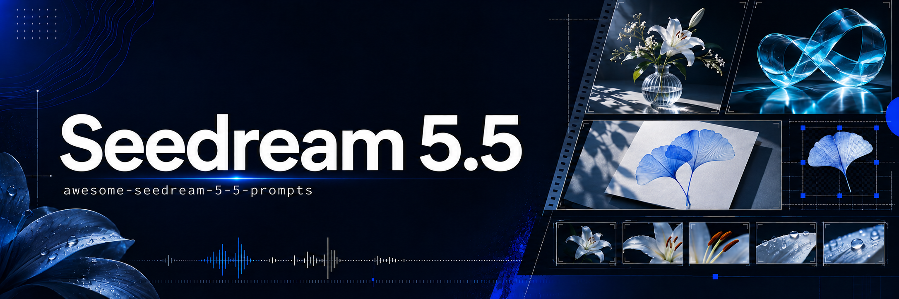

<p align="center"></p>

# Seedream 5.5 提示词精选

由 [BeatAPI](https://beatapi.io) 整理的提示词与对应素材，保留原作者、来源和必要参考图。

**[浏览在线画廊](https://beatapi.io/zh/seedream-5-5-prompts)** · **[Seedream 5.5 API](https://beatapi.io/zh/seedream-5-5-api)** · [English](README.md) · [参与贡献](CONTRIBUTING.md)

当前 28 条完整提示词案例，另含 17 项作品与对比展示，后续继续扩充。模型信息按创作者说明标注；素材为来源网站或原帖提供的版本。

**按用途浏览:** [文字排版](#文字排版) · [人物肖像](#人物肖像) · [透明素材](#透明素材) · [摄影](#摄影) · [产品摄影](#产品摄影) · [风景](#风景) · [图片编辑](#图片编辑) · [插画](#插画)

## 精选案例

### 杂志封面文字设计

[](cases/dheepan-typography-5.md)

<details>
<summary><strong>原始提示词</strong></summary>

```text
Premium magazine cover design titled “THE FUTURE OF CREATIVE TOOLS”, with a realistic portrait of a stylish creative director in the lower third. Dense small cover lines around the edges: “Issue 24”, “AI Workflows”, “Design Systems”, “Cinematic Image Making”, “Inside the Studio”, “November 2026”. Clean modern serif masthead, precise kerning, crisp letterforms, editorial grid, muted cream background, subtle paper texture, high-end print-design layout. All text must be spelled exactly as written, no distorted letters, no duplicated words, no gibberish.
```

</details>

[@Dheepanratnam](https://x.com/Dheepanratnam/status/2119767938173387065) · [完整案例与参考图](cases/dheepan-typography-5.md)

---

### 雨夜店面霓虹灯

[](cases/dheepan-typography-6.md)

<details>
<summary><strong>原始提示词</strong></summary>

```text
Photorealistic street scene in a multicultural London neighbourhood at night. A shopfront sign reads exactly “OPEN LATE” in English, with a smaller hanging sign reading exactly “欢迎光临” in simplified Chinese and another small poster reading exactly “Bienvenue” in French. Realistic neon glow, legible typography, correct character shapes, no duplicated letters, no warped glyphs, natural perspective on the signs, cinematic night photography, wet pavement reflections, no extra invented text.
```

</details>

[@Dheepanratnam](https://x.com/Dheepanratnam/status/2119767938173387065) · [完整案例与参考图](cases/dheepan-typography-6.md)

---

### 极简护肤品标签

[](cases/dheepan-typography-7.md)

<details>
<summary><strong>原始提示词</strong></summary>

```text
Minimalist skincare packaging mock-up on a pale stone pedestal. A frosted-glass serum bottle has a clean label reading exactly “LUMEN — BARRIER REPAIR SERUM”, with smaller text beneath: “30 ml / 1.0 fl oz”. Elegant sans-serif typography, perfectly straight label alignment, crisp small print, realistic glass refraction, soft studio lighting, subtle shadow, premium cosmetic advertising photography, no misspelled words, no extra branding, no watermark.
```

</details>

[@Dheepanratnam](https://x.com/Dheepanratnam/status/2119767938173387065) · [完整案例与参考图](cases/dheepan-typography-7.md)

---

### Night Signal 活动海报

[](cases/dheepan-typography-8.md)

<details>
<summary><strong>原始提示词</strong></summary>

```text
Bold gig poster for an underground electronic music night. Large headline reads exactly “NIGHT SIGNAL”, with supporting text: “Friday 27 November”, “Warehouse 9, London”, “Doors 10PM”. Experimental Swiss-style layout, high-contrast black, off-white and electric blue, grainy risograph texture, sharp geometric typography, intentional negative space, screen-print aesthetic. All words spelled exactly as specified, no extra text, no warped letters, no AI artefacts.
```

</details>

[@Dheepanratnam](https://x.com/Dheepanratnam/status/2119767938173387065) · [完整案例与参考图](cases/dheepan-typography-8.md)

---

### 双语拉面菜单

[](cases/spicyapi-seedream55-01.md)

<details>
<summary><strong>原始提示词</strong></summary>

```text
Overhead photo of a printed noodle shop menu on a dark wooden counter. Title 'KAZE RAMEN' in bold brush lettering, small Japanese subtitle '風ラーメン', and a neat list with exact text: 'Shoyu Ramen 980', 'Miso Ramen 1,050', 'Gyoza (6) 420', 'Oolong Tea 280'. Small footnote: 'Open daily 11:00-22:00'. A steaming bowl sits at the edge of the frame, soft window light.
```

</details>

[SpicyAPI Engineering](https://spicyapi.ai/reviews/seedream-5-5) · [完整案例与参考图](cases/spicyapi-seedream55-01.md)

---

### Noir 时尚杂志封面

[](cases/spicyapi-seedream55-02.md)

<details>
<summary><strong>原始提示词</strong></summary>

```text
Fashion magazine cover photograph. A woman in her early thirties with auburn hair in a low-cut emerald silk dress with thin straps, looking at the camera in soft window light. The only text on the cover: the large serif masthead 'NOIR', one small Japanese line '夜の特集', one small line 'Issue 12 · Autumn Nights', and a barcode in the lower corner. No other words anywhere.
```

</details>

[SpicyAPI Engineering](https://spicyapi.ai/reviews/seedream-5-5) · [完整案例与参考图](cases/spicyapi-seedream55-02.md)

## 浏览案例

### 文字排版

- [杂志封面文字设计](cases/dheepan-typography-5.md) — [@Dheepanratnam](https://x.com/Dheepanratnam/status/2119767938173387065)
- [雨夜店面霓虹灯](cases/dheepan-typography-6.md) — [@Dheepanratnam](https://x.com/Dheepanratnam/status/2119767938173387065)
- [极简护肤品标签](cases/dheepan-typography-7.md) — [@Dheepanratnam](https://x.com/Dheepanratnam/status/2119767938173387065)
- [Night Signal 活动海报](cases/dheepan-typography-8.md) — [@Dheepanratnam](https://x.com/Dheepanratnam/status/2119767938173387065)
- [双语拉面菜单](cases/spicyapi-seedream55-01.md) — [SpicyAPI Engineering](https://spicyapi.ai/reviews/seedream-5-5)
- [灯笼茶馆海报](cases/seedream-studio-poster.md) — [Seedream Studio](https://seedreamv5.com/seedream-5.5)
- [从种子到沙拉信息图](cases/bytedance-official-infographic.md) — [ByteDance Seed](https://seed.bytedance.com/en/seedream5_5)
- [莎士比亚文学报纸](cases/bytedance-official-newspaper.md) — [ByteDance Seed](https://seed.bytedance.com/en/seedream5_5)

### 人物肖像

- [Noir 时尚杂志封面](cases/spicyapi-seedream55-02.md) — [SpicyAPI Engineering](https://spicyapi.ai/reviews/seedream-5-5)
- [爵士酒吧中的舞者](cases/spicyapi-seedream55-04.md) — [SpicyAPI Engineering](https://spicyapi.ai/reviews/seedream-5-5)
- [逆光草地人像](cases/seedream-studio-portrait.md) — [Seedream Studio](https://seedreamv5.com/seedream-5.5)

### 透明素材

- [透明背景青色狐狸马克杯](cases/spicyapi-seedream55-03.md) — [SpicyAPI Engineering](https://spicyapi.ai/reviews/seedream-5-5)
- [拉面猫贴纸](cases/seedream-studio-sticker.md) — [Seedream Studio](https://seedreamv5.com/seedream-5.5)
- [天气图标九宫格](cases/seedream-studio-icon-set.md) — [Seedream Studio](https://seedreamv5.com/seedream-5.5)
- [琥珀香水瓶素材](cases/dheepan-asset-9.md) — [@Dheepanratnam](https://x.com/Dheepanratnam/status/2119767938173387065)
- [街头服饰人物素材](cases/dheepan-asset-10.md) — [@Dheepanratnam](https://x.com/Dheepanratnam/status/2119767938173387065)
- [磨砂亚克力片素材](cases/dheepan-asset-11.md) — [@Dheepanratnam](https://x.com/Dheepanratnam/status/2119767938173387065)
- [镀铬丝带标志](cases/dheepan-asset-12.md) — [@Dheepanratnam](https://x.com/Dheepanratnam/status/2119767938173387065)

### 摄影

- [维多利亚温室中的植物学家](cases/seedream-studio-hero.md) — [Seedream Studio](https://seedreamv5.com/seedream-5.5)
- [日式熟食店三模型对比](cases/genel-japanese-deli-comparison.md) — [@genel_ai](https://x.com/genel_ai/status/2119786434567827504)
- [阳光、灰泥与亚麻](cases/bytedance-official-street.md) — [ByteDance Seed](https://seed.bytedance.com/en/seedream5_5)

### 产品摄影

- [手冲咖啡产品静物](cases/seedream-studio-product.md) — [Seedream Studio](https://seedreamv5.com/seedream-5.5)

### 风景

- [冰川山谷日出](cases/seedream-studio-panorama.md) — [Seedream Studio](https://seedreamv5.com/seedream-5.5)

### 图片编辑

- [阳光咖啡馆原始画面](cases/seedream-studio-edit-base.md) — [Seedream Studio](https://seedreamv5.com/seedream-5.5)
- [咖啡馆编辑：冰咖啡](cases/seedream-studio-edit-r1.md) — [Seedream Studio](https://seedreamv5.com/seedream-5.5)
- [咖啡馆编辑：遮阳篷条纹](cases/seedream-studio-edit-r2.md) — [Seedream Studio](https://seedreamv5.com/seedream-5.5)
- [咖啡馆编辑：熟睡的腊肠犬](cases/seedream-studio-edit-r3.md) — [Seedream Studio](https://seedreamv5.com/seedream-5.5)

### 插画

- [蓝莓角色设计板](cases/bytedance-official-character.md) — [ByteDance Seed](https://seed.bytedance.com/en/seedream5_5)

## 作品与模型对比

17 项已授权展示：13 张作品、4 张多模型对比。未提供完整提示词，不创建独立案例页。

### 1. 咖啡馆人像


Seedream 5.5 · 来源预览图

[@Dheepanratnam](https://x.com/Dheepanratnam/status/2119762628658462746)


### 2. 暮色雨街


Seedream 5.5 · 来源预览图

[@Dheepanratnam](https://x.com/Dheepanratnam/status/2119762628658462746)


### 3. 窗边咖啡


Seedream 5.5 · 来源预览图

[@Dheepanratnam](https://x.com/Dheepanratnam/status/2119762628658462746)


### 4. 早餐静物


Seedream 5.5 · 来源预览图

[@Dheepanratnam](https://x.com/Dheepanratnam/status/2119762628658462746)


### 5. 眼部细节


Seedream 5.5 · 来源预览图

[@Yuziyyaa](https://x.com/Yuziyyaa/status/2119799602580955179)


### 6. 街边用餐人像


Seedream 5.5 · 来源预览图

[@DrSadek_](https://x.com/DrSadek_/status/2119788316153507886)


### 7. 咖啡桌上的茶具


Seedream 5.5 · 来源预览图

[@DrSadek_](https://x.com/DrSadek_/status/2119788316153507886)


### 8. 钟表匠的双手


Seedream 5.5 · 来源预览图

[@kevinchin35](https://x.com/kevinchin35/status/2119747692427628777)


### 9. 林间地面


Seedream 5.5 · 来源预览图

[@kevinchin35](https://x.com/kevinchin35/status/2119747692427628777)


### 10. 覆盆子气泡水


Seedream 5.5 · 来源预览图

[@kevinchin35](https://x.com/kevinchin35/status/2119747692427628777)


### 11. 雨夜之城动漫海报


Seedream 5.5 · 来源预览图

[@TqMiracle18260](https://x.com/TqMiracle18260/status/2119765639825089008)


### 12. 人工智能会议海报


Seedream 5.5 · 来源预览图

[@TqMiracle18260](https://x.com/TqMiracle18260/status/2119765639825089008)


### 13. 窗光人像


Seedream 5.5 · 来源预览图

[@TqMiracle18260](https://x.com/TqMiracle18260/status/2119765639825089008)


### 14. 茶馆场景：三模型对比


模型顺序：Seedream 5.5 / GPT Image 2.6 / Nano Banana 2.1 · 来源预览图

[@ozansihay](https://x.com/ozansihay/status/2119803963738357803)


### 15. 金色田野：三模型对比


模型顺序：Seedream 5.5 / GPT Image 2.6 / Nano Banana 2.1 · 来源预览图

[@ozansihay](https://x.com/ozansihay/status/2119803963738357803)


### 16. 酒馆人像：三模型对比


模型顺序：Seedream 5.5 / GPT Image 2.6 / Nano Banana 2.1 · 来源预览图

[@ozansihay](https://x.com/ozansihay/status/2119803963738357803)


### 17. 夜景人像：三模型对比


模型顺序：Seedream 5.5 / GPT Image 2.6 / Nano Banana 2.1 · 来源预览图

[@ozansihay](https://x.com/ozansihay/status/2119803963738357803)


## 来源与许可

每条案例提供原文、创作者、素材和必要的参考图。项目所有者已确认素材使用授权；第三方素材不因此自动获得通用许可。仓库原创文档采用 [MIT 许可](LICENSE)。封面是示意插画，不作为 Seedream 成品。
